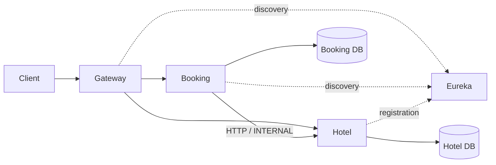
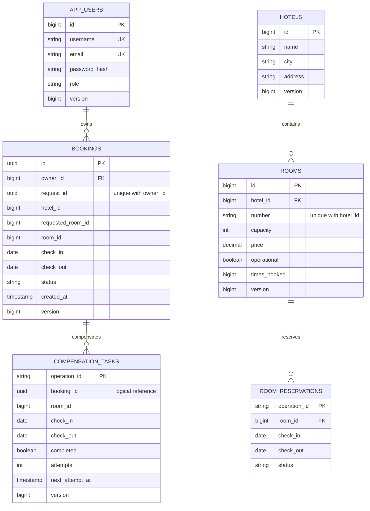
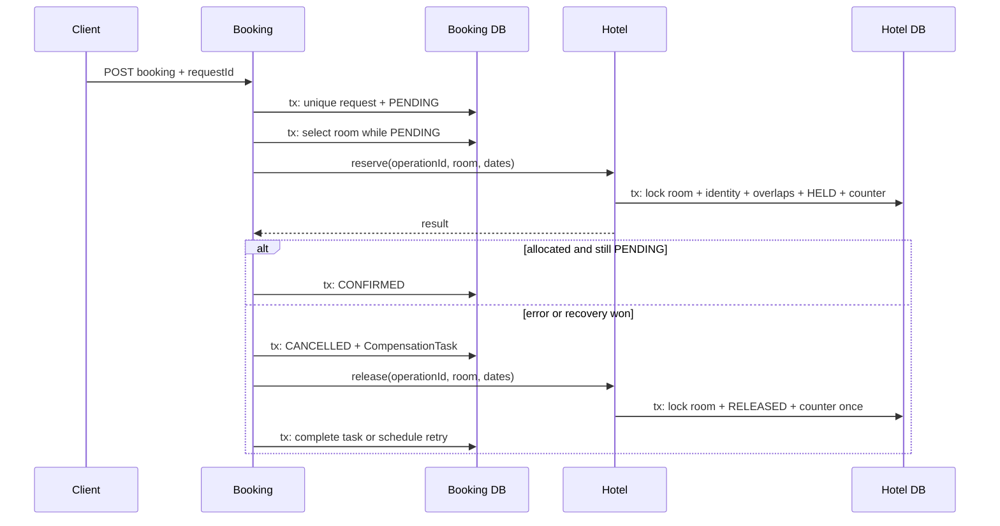

# Hotel Management

Четыре сервиса на Java 21, Spring Boot 3.5.7 и Spring Cloud 2025.0.0.
Maven, Spring MVC/JPA для бизнес-сервисов, WebFlux для Gateway, Eureka,
H2, Spring Security OAuth2 Resource Server и Resilience4j.

## Требования и запуск

Для работы проекта нужны JDK 21 и Maven 3.9+.

```sh
mvn -B -ntp spotless:check verify
```
Для запуска необходимо открыть четыре терминала в корне проекта после сборки:

```sh
java -jar service-registry/target/service-registry-1.0.0-SNAPSHOT-exec.jar
```

```sh
java -jar hotel-management-service/target/hotel-management-service-1.0.0-SNAPSHOT-exec.jar --spring.profiles.active=demo
```

```sh
java -jar booking-service/target/booking-service-1.0.0-SNAPSHOT-exec.jar --spring.profiles.active=demo
```

```sh
java -jar api-gateway/target/api-gateway-1.0.0-SNAPSHOT-exec.jar --spring.profiles.active=demo
```

| Сервис | Порт | Пакет / главный класс |
|---|---:|---|
| service-registry | 8761 | ru.basmathy.registry.ServiceRegistryApplication |
| api-gateway | 8080 | ru.basmathy.gateway.ApiGatewayApplication |
| hotel-management-service | 8081 | ru.basmathy.hotel.HotelManagementApplication |
| booking-service | 8082 | ru.basmathy.booking.BookingApplication |

Eureka UI: http://localhost:8761. Health: /actuator/health на каждом порту.
После старта дождитесь регистрации сервисов и обновления кеша Gateway
(обычно до 30 секунд). Клиентский API: http://localhost:8080.
Для прямого подключения Booking к Hotel задайте HOTEL_URL=http://localhost:8081;
по умолчанию используется discovery и http://hotel-management-service.

Вне demo задайте одинаковый JWT_SECRET во всех трёх API-сервисах и
INTERNAL_TOKEN в Booking/Hotel; секретов по умолчанию для обычного профиля нет.
JWT_SECRET должен содержать минимум 32 UTF-8 байта, INTERNAL_TOKEN — 12 символов.
Значения demo предназначены только для локального запуска.

| Переменная / свойство | Значение по умолчанию |
|---|---|
| EUREKA_URL | http://localhost:8761/eureka/ |
| HOTEL_URL | http://hotel-management-service |
| hotel.connect-timeout / hotel.read-timeout | PT0.5S / PT1S |
| hotel.retry-attempts | 3 |
| saga.recovery-age | PT2M |
| saga.retry-delay-ms / saga.recovery-delay-ms | 10000 / 30000 |
| saga.scheduling-enabled | true |
| spring.datasource.url | отдельная H2 in-memory каждого бизнес-сервиса |

Для локального сохранения данных можно передать
--spring.datasource.url=jdbc:h2:file:./data/hotel;LOCK_TIMEOUT=2000 в Hotel
и аналогичный URL с ./data/booking в Booking. В PowerShell заключите весь
аргумент с точкой с запятой в кавычки. Пользователь/пароль БД меняются
стандартными SPRING_DATASOURCE_USERNAME / SPRING_DATASOURCE_PASSWORD.
Схема создаётся Hibernate ddl-auto=update; управляемые миграции в эту версию не входят.

## Демонстрация

DemoDataInitializer запускается исключительно с профилем demo.
Создаёт отель Basmathy Hotel в Yekaterinburg, номера 101/102 и
выведенный из эксплуатации 103. Данные не перезаписываются при непустых таблицах.

| Логин | Пароль | Роль |
|---|---|---|
| admin | AdminDemo123! | ADMIN |
| guest | GuestDemo123! | USER |

Примеры Bash (в Windows используйте curl.exe и подходящее экранирование JSON):

```sh
curl -X POST http://localhost:8080/api/auth/register -H 'Content-Type: application/json' \
  -d '{"username":"alice","email":"alice@example.test","password":"Password123!"}'
```

```sh
curl -X POST http://localhost:8080/api/auth/login -H 'Content-Type: application/json' \
  -d '{"username":"guest","password":"GuestDemo123!"}'
```

Скопируйте accessToken из ответа:
```sh
TOKEN='<accessToken>'
curl http://localhost:8080/api/hotels -H "Authorization: Bearer $TOKEN"
curl 'http://localhost:8080/api/rooms?hotelId=1&minCapacity=2&page=0&size=10' \
  -H "Authorization: Bearer $TOKEN"
```

Выберите будущие даты и реальный hotelId/roomId из GET:
```sh
curl -X POST http://localhost:8080/api/bookings \
  -H "Authorization: Bearer $TOKEN" -H 'Content-Type: application/json' \
  -H 'X-Correlation-ID: demo-booking-1' \
  -d '{"requestId":"a4f8ec44-456e-4c1b-bca9-d9b207c84035","hotelId":1,"roomId":1,"checkIn":"2030-05-01","checkOut":"2030-05-04"}'
```

roomId=null (или пропущен) включает автоподбор:
```sh
curl -X POST http://localhost:8080/api/bookings \
  -H "Authorization: Bearer $TOKEN" -H 'Content-Type: application/json' \
  -d '{"requestId":"c1fa3c26-d97d-44a9-8cba-c31328c92d7f","hotelId":1,"checkIn":"2030-06-01","checkOut":"2030-06-04"}'
```

BOOKING_ID='<id из ответа>'
```sh
curl -X POST "http://localhost:8080/api/bookings/$BOOKING_ID/cancel" \
  -H "Authorization: Bearer $TOKEN"
```

Для CRUD войдите как admin. Например:
```sh
curl -X POST http://localhost:8080/api/hotels \
  -H "Authorization: Bearer $ADMIN_TOKEN" -H 'Creontent-Type: application/json' \
  -d '{"name":"New Hotel","city":"Moscow","addss":"Street 1"}'
```

```sh
curl -X POST http://localhost:8080/api/rooms \
  -H "Authorization: Bearer $ADMIN_TOKEN" -H 'Content-Type: application/json' \
  -d '{"hotelId":1,"number":"104","capacity":2,"price":4500.00,"operational":true}'
```

## HTTP-контракты

| Метод | Путь | Доступ / назначение |
|---|---|---|
| POST | /api/auth/register | публично; регистрация USER |
| POST | /api/auth/login | публично; JWT на 3600 секунд |
| GET | /api/users, /api/users/{id} | ADMIN; список/пользователь |
| PUT, DELETE | /api/users/{id} | ADMIN; обновление email/password/role, удаление |
| GET | /api/hotels | USER/ADMIN; name, city, page, size, sort |
| GET | /api/hotels/{id} | USER/ADMIN |
| POST | /api/hotels | ADMIN; name, city, address |
| PUT, DELETE | /api/hotels/{id} | ADMIN |
| GET | /api/rooms | USER/ADMIN; hotelId, minCapacity, maxPrice, operational, page, size, sort |
| GET | /api/rooms/{id} | USER/ADMIN |
| POST | /api/rooms | ADMIN; hotelId, number, capacity, price, operational |
| PUT, DELETE | /api/rooms/{id} | ADMIN; hotelId менять нельзя |
| GET | /api/rooms/recommendations | USER/ADMIN; hotelId (необязательно), capacity (1), checkIn, checkOut |
| GET | /api/rooms/{id}/statistics | ADMIN; checkIn, checkOut |
| GET | /api/hotels/{id}/statistics | ADMIN; checkIn, checkOut |
| POST | /api/bookings | USER/ADMIN; requestId UUID, hotelId, roomId?, checkIn, checkOut |
| GET | /api/bookings | свои брони; ADMIN видит все; page, size, sort |
| GET | /api/bookings/{id} | владелец/ADMIN |
| POST | /api/bookings/{id}/cancel | владелец/ADMIN; повтор безопасен |
| GET | :8081/internal/rooms/available | только INTERNAL; hotelId, checkIn, checkOut |
| GET | :8081/internal/rooms/{id} | только INTERNAL; проверка номера |
| POST | :8081/internal/rooms/{id}/reservations | только INTERNAL; operationId, checkIn, checkOut |
| POST | :8081/internal/rooms/{id}/reservations/release | только INTERNAL; те же параметры |

INTERNAL требует X-Internal-Token, через Gateway не маршрутизируется;
пользовательские USER/ADMIN не заменяют эту авторизацию.
Даты — ISO yyyy-MM-dd, выезд строго после заезда. Новый заезд в прошлом
запрещён. Повтор уже принятого ключа проверяется по исходным параметрам.
Размер страницы по умолчанию 20, максимум 200. Номер имеет уникальный
number в пределах отеля; username и email уникальны без учёта регистра.

POST брони возвращает 201 с конечной бронью либо 202 при параллельном повторе
ещё выполняющегося PENDING. Идемпотентный повтор конечной записи также даёт 201,
включая CANCELLED; он не перезапускает сагу. Итог проверяется по полю status.
При отказе исходного вызова возможен 409/503, а созданная бронь остаётся
CANCELLED и видна в списке.

Основные ошибки: 400 — валидация, 401 — JWT/учётные данные,
403 — роль/владение, 404 — объект отсутствует, 409 — занятый номер,
изменённые параметры ключа, ограничение удаления или конфликт БД,
503 — зависимость недоступна; Gateway может вернуть 504 при тайм-ауте. Ошибки контроллеров содержат timestamp,
status, code, message, path, correlationId, validationErrors.
Ошибки аутентификации обрабатывает Spring Security.
X-Correlation-ID возвращается также в заголовке ответа.

Удалить отель можно только без номеров; номер — только без истории
резервирований, включая RELEASED. Для вывода номера из использования задайте
operational=false через PUT. Удаление пользователя с историей бронирований запрещено.

## Архитектура



В каждом бизнес-сервисе:
- domain/model — сущности, StayPeriod и контролируемые переходы состояния;
- domain/policy — объектные правила доступа/удаления, стратегия выбора;
- application/service — сценарии и локальные транзакции;
- application/port — HTTP-граница и заменяемая стратегия;
- infrastructure/persistence — Spring Data JpaRepository и запросы;
- infrastructure/client — HTTP-адаптер в Booking;
- presentation/controller, presentation/dto — MVC и DTO/мапперы;
- configuration — безопасность, клиент, устойчивость, demo и корреляция.



Базы изолированы: hotelId/roomId в Booking — внешние идентификаторы без FK
в другую БД. CompensationTask хранит копию данных операции для независимого
повтора, bookingId — логическая ссылка в локальной БД.

## Сага и идемпотентность



При автоподборе сначала фильтруются занятые/недоступные номера,
затем LeastBookedRoomSelectionStrategy сортирует timesBooked ASC, id ASC.
Однозначный конфликт одного кандидата позволяет попробовать следующего.
Timeout/потеря ответа требуют компенсации: отсутствие ответа не доказывает,
что Hotel не выделил слот. Отметка RELEASED делает поздний reserve безопасным.

Подробности и ограничения:
[блокировки](docs/adr/001-room-locking.md),
[безопасность](docs/adr/002-security.md),
[сага и компенсации](docs/adr/003-compensation.md).

Логи INFO показывают начало саги, выделение/освобождение, смену статуса
и попытки компенсации; correlationId включён в MDC и передаётся HTTP.
JWT, пароли и тела запросов не логируются.

## Статистика

Период [checkIn, checkOut), D = число календарных ночей.
Учитываются только HELD-резервирования, пересекающие период:
- bookingCount = число таких резервирований, включая начавшиеся ранее;
- occupiedNights = сумма длин пересечений с выбранным периодом;
- capacityNights номера = D, если operational=true, иначе 0;
- occupancyRate = occupiedNights / capacityNights; при нулевом знаменателе null.

Для неэксплуатируемого номера ответ сохраняет его реальные count/nights,
но коэффициент равен null. Сводка отеля суммирует count/nights только
эксплуатируемых номеров, знаменатель = D × число таких номеров.
Список rooms дополнительно содержит все номера, включая отключённые.
Доля лежит в [0,1], пока соблюдается запрет пересечений. Это снимок текущих
неотменённых резервирований, а не архив фактически состоявшихся проживаний.
История периодов технического обслуживания не хранится: текущее operational
применяется ко всему запрошенному окну. Для исторической загрузки нужна
отдельная модель интервалов обслуживания/истории отмен.

## Тесты и CI

```sh
mvn -B -ntp test
mvn -B -ntp test -pl hotel-management-service -am
mvn -B -ntp test -pl booking-service -am
mvn -B -ntp test -pl api-gateway -am
mvn -B -ntp test -pl booking-service -am -Dtest=DistributedBookingTest -Dsurefire.failIfNoSpecifiedTests=false
mvn -B -ntp spotless:apply
mvn -B -ntp spotless:check verify
```

JUnit 5/AssertJ/Mockito проверяют модель и координатор; MockMvc — роли,
реальную выдачу/проверку JWT, CRUD, владельца, валидацию и идемпотентность.
JPA+H2 — ограничения ключей, пересечения, ожидание блокировки и конкурентные
резервирования. WireMock — 5xx, retry, read timeout, breaker и заголовки.

DistributedBookingTest сам поднимает два Spring-приложения на случайных портах,
отдельные H2-базы и управляемый HTTP-прокси для потери/удержания ответов.
Проверяются все десять сложных сценариев из задания, включая финальные
записи обеих БД. Конкурентные тесты используют ExecutorService,
CyclicBarrier и CountDownLatch; Thread.sleep в тестах отсутствует.
Gateway проверяется WebTestClient с настоящими JWT и локальной HTTP-заглушкой.
Фикстуры тестов не зависят от demo-профиля. GitHub Actions запускает
форматирование, сборку, эти же тесты и сохраняет отчёты Surefire.
